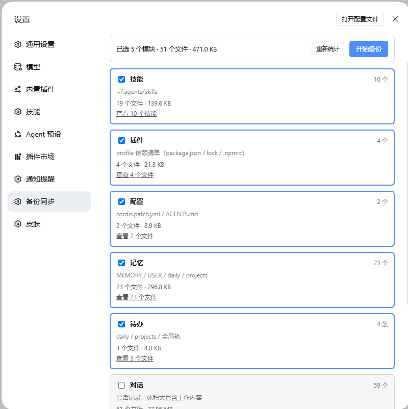
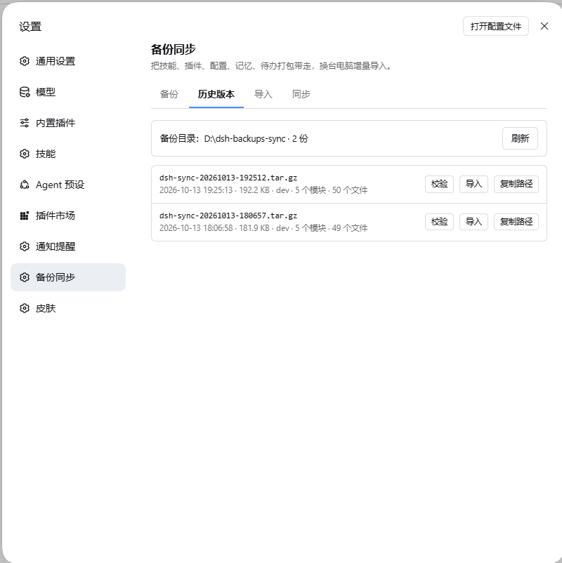
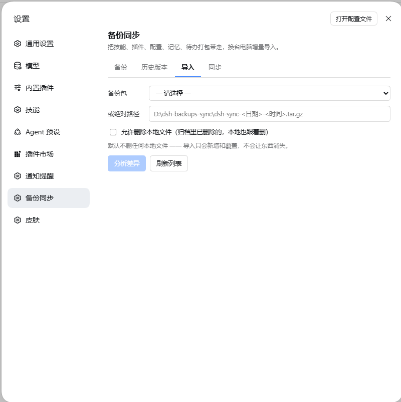
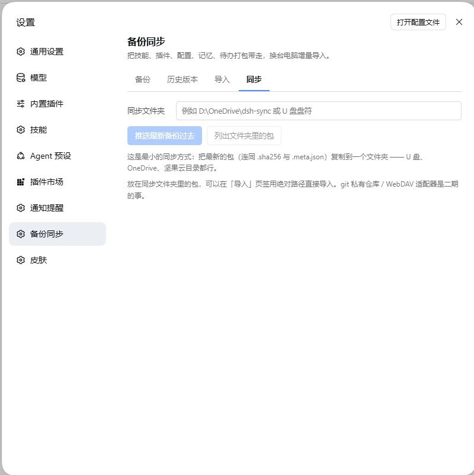
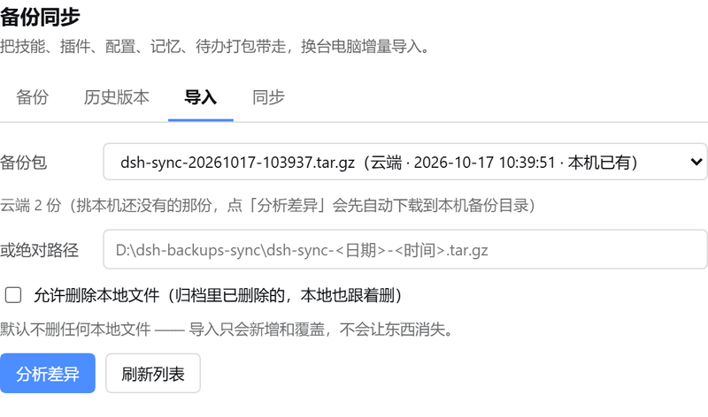

# dsh-backup-sync

> 给 **DeepSeek Harness** 的**备份 / 恢复 / 换机同步**插件：
> 把技能、插件、配置、记忆、待办打成一个 `tar.gz`，换台电脑**按模块增量导入**，
> 靠一份基线库做三方合并 —— 不覆盖你在这台机器上新改的东西。
> 也能直接把包推到**你自己的 WebDAV 空间**（绿联 / 群晖 / 坚果云 / Nextcloud…），换机时下载回来。

[](https://github.com/Arlenman/dsh-backup-sync/actions/workflows/ci.yml)
[](LICENSE)
[](package.json)

---

## 目录

- [它解决什么问题](#它解决什么问题)
- [和 dsh-backup 有什么不同](#和-dsh-backup-有什么不同)
- [安装](#安装)
- [界面](#界面)
- [六个模块](#六个模块)
- [文件放在哪](#文件放在哪)
- [增量导入：基线三方合并](#增量导入基线三方合并)
- [两条红线](#两条红线)
- [定时备份](#定时备份)
- [云端备份（WebDAV）](#云端备份webdav)
- [HTTP 接口](#http-接口)
- [开发](#开发)
- [已知限制](#已知限制)
- [English](#english)
- [License](#license)

---

## 它解决什么问题

DSH 的「资产」散落在**两个地方**：

| 资产 | 位置 |
| --- | --- |
| 技能（工作流本体） | `<userHome>/.agents/skills` |
| 插件清单 / 依赖锁 | `<dshHome>/profiles/<profile>/` |
| 核心配置（provider、模型、主题、插件配置） | `<dshHome>/profiles/<profile>/cordis.patch.yml` |
| 记忆 / 待办 | `<dshHome>/memories/` |
| 对话记录 | `<dshHome>/sessions/` |

其中 `<dshHome>` 默认是 `~/.dsh`，而**技能根本不在它下面**。
换电脑时最容易丢的恰好是技能和配置 —— 而它们又最值钱。

这个插件把上面这些一起打包，并且解决第二个问题：**导入时不要把人家的新东西冲掉**。

## 和 dsh-backup 有什么不同

[`@xiaoyuyu6420/dsh-backup`](https://www.npmjs.com/package/@xiaoyuyu6420/dsh-backup) 是一个成熟的全量备份插件（本插件作者也在用），但它的 `skills` 类型找的是 `~/.dsh/skills`；技能库实际住在 `~/.agents/skills`（`~/.dsh` 之外），所以在技能装在标准位置的机器上，**它备不到技能**。

两者的定位：

| | dsh-backup | dsh-backup-sync（本插件） |
| --- | --- | --- |
| 备份范围 | `~/.dsh` 整棵树（可按类型排除） | 六个模块，**含 `~/.agents/skills`** |
| 导入语义 | 恢复（覆盖） | **带基线的三方合并**，逐文件给差异 |
| 冲突处理 | — | 弹差异预览，逐文件选保留哪边 |
| 云同步 | 内置 GitHub 私有仓库同步 | 推送到「同步目录」（可指向任何被同步工具盯着的目录） |
| 救援 | 有进程外救援脚本 | — |

**两个可以同时装**，互不干扰（备份目录、状态文件都不同名）。

## 安装

```bash
# 从 GitHub 装（推荐锁 tag，可复现）
dsh plugin --profile web add github:Arlenman/dsh-backup-sync#v0.2.0

# 跟 main 分支走
dsh plugin --profile web add github:Arlenman/dsh-backup-sync

# 或直接用发行版里的 tar.gz
dsh plugin --profile web add https://github.com/Arlenman/dsh-backup-sync/releases/download/v0.2.0/dsh-backup-sync-0.2.0.tgz
```

桌面版（Electron）在 **设置 → 插件** 里粘贴上面任意一条即可。

**换台电脑（家里另一台）就填这一条**：

```
github:Arlenman/dsh-backup-sync#v0.2.0
```

这条路已经实测过（2026-10-15，拿 `github:Arlenman/dsh-backup-sync#v0.1.0` 对**真仓库**跑 `pnpm add`，
51.5 秒装完）：pnpm 拉的是 codeload 从仓库树打的 tarball（锁文件里记的是 `gitHosted: true` +
sha512 integrity），当时装出来 **22 个文件**（`lib/*.js` 18 个 + `package.json` + `cordis.patch.yml`
+ `README.md` + `LICENSE`），与 Release 里那个 `.tgz` **逐个文件、逐字节一致**（22/22，sha256 全等）；
解析到的提交是 `289819f`（= 当时的 tag `v0.1.0`），装出来的 `lib/index.js` 用 node 直接 import 就能加载。
`v0.2.0` 的包是 **25 个文件**（`lib/*.js` 21 个 + `package.json` + `cordis.patch.yml` + `README.md` + `LICENSE`，
打包后 **130,583 字节**），**安装路径一字未变**。
仓库里**没有 `prepare` / `prepublish` / `postinstall` 脚本、没有 `dependencies`**，
`lib/` 是提交进仓库的现成 JS ⇒ **目标机器不需要构建，也不需要装任何依赖**。

两个前提：

- 目标机器要能连上 `github.com`。插件管理器在装 git 依赖前有 **5 秒** github.com 预检，
  之后 pnpm 拉 `codeload.github.com` 的 tarball（**60 秒** idle 超时）。包本体约 130 KB，慢网也够。
- 装完**重启一次 DSH**（宿主半边不热重载，见下）。

> **暂未发布到 npm**，所以 `dsh plugin --profile web add dsh-backup-sync`
> 这个写法现在装不到东西 —— 请用上面的 GitHub 写法。

> **注意**：插件的宿主半边（HTTP 路由）**不热重载**，装完要重启一次 DSH；
> 界面半边刷新页面即可生效。

要求：DSH `0.2.0-rc.2`，Node.js ≥ 22。零 npm 运行时依赖（只用 Node 内置模块 + 平台提供的 `react`；打包那一步调用系统自带的 `tar`）。

## 界面

入口在 **设置 → 备份同步**（与「插件」「技能」并列），四个页签：

| 备份 | 历史版本 |
| --- | --- |
|  |  |

| 导入 | 同步 |
| --- | --- |
|  |  |

- **备份**：勾模块 → 填输出目录 → 打一个包（可选打包前跑校验）。
  卡片展开后给的是**人话清单**，不是文件路径：技能卡一行一个技能，插件卡一行一个插件
  （显示名 / 真正装上的版本 / `已启用 · 仅依赖 · 未安装 · 内置 · 本地目录` 徽标，悬停看说明、
  单击开详情、双击复制包名），文件明细退成旁边一条「查看 N 个文件」。
- **历史版本**：列出输出目录里的包（时间、体积、来源机器、模块数、文件数），
  可就地**校验**（比对 sha256）、**导入**、**复制路径**。
- **导入**：选一个包 → 扫描 → 逐文件差异预览（新增 / 修改 / 删除 / 冲突）→ 逐项裁决 → 应用。
  应用前自动把当前状态快照到 `<输出目录>/pre-restore-<时间戳>/`。
  「备份包」下拉分**本机**与**云端（WebDAV）**两组，云端每项标着「本机已有 / 本机没有」；
  挑云端那份点「分析差异」时**本机没有的会自动下载**（本机已有就跳过，不白下几百 MB）。
- **同步**：把包推到「同步目录」（OneDrive / 坚果云 / 群晖 / U 盘都行），带 sha256 校验。
  下面还有一张**云端（WebDAV）**卡片：填地址 / 账号 / 口令 / 远端目录 →「保存并测试连接」→
  上传 / 列出远端 / 下载到本机 / 删远端（详见[云端备份](#云端备份webdav)）。

## 六个模块

| 模块 | 界面名 | 根目录 | 收录内容 | 默认 |
| --- | --- | --- | --- | --- |
| `skills` | 技能 | `<userHome>/.agents/skills` | 整棵技能树（按技能目录计数） | ✅ |
| `plugins` | 插件 | `<dshHome>/profiles/<profile>/` | `package.json`、`pnpm-lock.yaml`、`.npmrc`、`pnpm-workspace.yaml`（界面上另按清单列出**装了哪些插件**） | ✅ |
| `config` | 配置 | `<dshHome>/profiles/<profile>/` 与 `<dshHome>/` | `cordis.patch.yml`、`settings.yaml`、`AGENTS.md` | ✅ |
| `memory` | 记忆 | `<dshHome>/memories/` | `MEMORY.md` / `USER.md` / `KEY.md` / `daily/*.md` 等（**不含**待办文件） | ✅ |
| `todo` | 待办 | `<dshHome>/memories/` | `TODOS-life.md`、`TODOS-work.md`、`projects/<hash>/TODOS.md`、`daily/YYYY-MM-DD.todo.md` | ✅ |
| `sessions` | 对话 | `<dshHome>/sessions/` | 全部会话记录 | ⬜ **本地专用 · 不上云** |

两个设计细节：

1. **模块按「文件模式」切分，不按目录切分**。记忆与待办同居 `memories/` 一棵树：
   `projects/<hash>/MEMORY.md` 是记忆，隔壁的 `projects/<hash>/TODOS.md` 是待办。
   按目录切必然切错，所以用文件模式互斥认领（有测试钉住「每个路径恰好属于一个模块」）。
2. **对话默认不勾选**，并在界面上标注「本地专用 · 不上云」——它体积大、含隐私，
   而且通常没必要跟着人走。

## 文件放在哪

插件自己的状态（都在本机，不进包）：

```
<dshHome>/backup-sync/settings.json   # 你的设置（输出目录、同步目录、定时…）
<dshHome>/backup-sync/state.json      # 基线库：上次打包时各文件的 sha256
```

备份包（默认输出目录，可用设置覆盖）：

```
dsh-sync-20261014-093012.tar.gz        # 归档本体
dsh-sync-20261014-093012.tar.gz.sha256 # 边车校验文件
```

包内结构（归档内是**归一化布局**，与机器无关）：

```
dsh/      ← 对应 <dshHome> 下的文件（profiles/… memories/… sessions/…）
agents/   ← 对应 <userHome>/.agents 下的文件（skills/…）
manifest.json   ← 格式版本、时间、来源机器、模块清单、逐文件 sha256
```

默认输出目录的选取规则：Windows 上确实存在 `D:` 盘、且 `<dshHome>` 位于
`<userHome>` 之下（判定为「真实安装」）时用 `D:\dsh-backups-sync`；
否则落在 `<userHome>/dsh-backups-sync`。
**绝不默认写到一个这台机器上不存在的路径。**

## 增量导入：基线三方合并

导入不是「解压覆盖」，而是三方合并：

```
base   = 基线库（上次打包时，两边都认可的共同祖先）
ours   = 这台机器现在的状态
theirs = 包里的状态
```

逐文件判定：

| 情况 | 动作 |
| --- | --- |
| 只有 `theirs` 变了 | 采纳包里的版本 |
| 只有 `ours` 变了 | **保留本地**，静默跳过 |
| 两边都变了且内容不同 | **冲突** → 弹差异预览，逐个选 |
| 本地删了、包里改了 | 冲突（默认保留本地） |
| 包里删了、本地没动 | 删除（需显式开启 `allowDelete`，默认关闭） |

几个刻意的选择：

- **冲突默认「保留本地」**。裁决完之后，基线记的是**归档版本**而不是本地版本 ——
  否则下次导入会把用户刚裁决保留的版本判成「归档改了、本地没动」而擅自覆盖，裁决等于白做。
- **合并粒度按内容类型定**：技能 = 整个目录；配置文件 = 整个文件（默认保留本地）；
  插件清单 = JSON 字段级；记忆 = 按内容行去重；待办 = 按 8 位十六进制 id；会话 = 整个文件。
- **删除是关着的**。`allowDelete` 默认 `false`，想同步「删除」这个动作必须手动开。
- **导入前自动快照**：`<输出目录>/pre-restore-<时间戳>/` 就是一份能原样还原的包。

## 两条红线

1. **凭据永不进包、永不进基线。** `~/.dsh/.credentials.yaml` 之类的凭据文件在扫描阶段
   就被排除（26 个凭据文件名 + 7 个后缀的黑名单，另有 1 MiB 内容闸）。
   **导入侧还会再拦一次**：老版本打的包、别人给的包里若带着这类文件，只会显示为
   「跳过」，不会写进本机。包里不可能出现 API key。
2. **对话默认不参与。** 想备份对话要手动勾 —— 它只在本机流转，不会被同步。

## 定时备份

在设置里打开后，插件在宿主进程里定时打包。两种频率：**每天某个时刻**（默认 `03:00`）
或**每隔 N 小时**（1–720，默认 24）。约定：

- **DSH 没开就不补跑**（不做启动补跑，也不装系统计划任务）；
- **失败不重试**，下一次到点照常；
- 只清理**自己打的包**，且 `keep <= 0` 表示不清理；
- 「立即跑一次」按钮绕过开关，用于验证；
- 定时范围默认跟随「备份」页当前勾选的模块，可 pin 成固定集合；
- **对话永远不会进定时包。**

## 云端备份（WebDAV）

「同步」页签里有一张**云端（WebDAV）**卡片。填四个字段就能用：

| 字段 | 例子 | 说明 |
| --- | --- | --- |
| 云端地址 | `http://192.168.3.1:5005/` | NAS 上 WebDAV 服务给出的地址（**要带协议**，端口按 NAS 说明填） |
| 账号 / 口令 | `dsh` / `******` | 口令建议用 NAS 里给应用生成的**专用密码**，不要用登录密码 |
| 远端目录 | `dsh-backup` | 云端根目录下的一个子目录，**第一次上传会自动创建** |
| 传完自动上传 | 开关 | 打开后每次「立即跑一次」或定时打包成功，自动把最新的包传上去 |

点「保存并测试连接」会当场告诉你通不通（口令错会明确显示 `401`）；界面上还有
**传最新一份上去 / 列出远端 / 下载到本机 / 删远端** 四个动作。

换机流程：新机器装好插件 → 填**同一个** WebDAV 地址与目录 → 到「导入」页签展开「备份包」下拉，
云端那一组里直接挑（每项都标着「本机已有 / 本机没有」）→ 点「分析差异」，
**本机没有的会先自动下载**（带 `.sha256` 的核对哈希）→ 预览 → 应用。

也可以走同步页签：「列出远端」→「下载到本机」→ 再回「导入」页签选它 —— 两条路等价。



上图是真机截的：下拉里选中的就是云端那份（`云端 · 2026-10-17 10:39:51 · 本机已有`），
下面一行说明云端一共几份、点「分析差异」会发生什么。

安全约定（这几条是硬编码的，不是提示）：

- 口令**单独**存在 `<dshHome>/backup-sync/cloud-credentials.json`（权限 `0600`），
  不进设置文件、不进日志、界面里读不回来（只显示「已保存」）。
- 这个凭据文件名在黑名单里 —— **既不会被打进备份包，也不会被导入**。
- 远端只认**自己打的包**：名字必须匹配 `dsh-sync-<时间戳>.tar.gz`。别的名字（包括
  `../` 这类路径穿越）一律拒绝，**而且拒绝发生在发请求之前**。
- 上传/下载/删除都会核对 `sha256` 边车文件；下载采用「先写临时文件再改名」，
  同名包默认不覆盖（要显式确认）。
- ⚠️ **备份包里是明文**（配置、技能、待办、记忆）。所以云端目录必须是**私有**的，
  别用公开分享目录。要加密请自己在外面套一层（如 restic / rclone crypt）。

兼容性：只依赖 WebDAV 标准动词（`OPTIONS` / `PROPFIND` / `MKCOL` / `PUT` / `GET` / `DELETE`），
Basic 认证，不依赖任何厂商私有 API。NAS 上记得**先把 WebDAV 服务打开**。
真机实测的服务器方言记在 [`docs/notes/webdav-servers.md`](docs/notes/webdav-servers.md)。

## HTTP 接口

宿主半边在 `/api/dsh-backup-sync` 下注册了 20 条路由（都走 DSH 自带的连接鉴权）：

```
GET  /state               GET  /settings          POST /settings
POST /backup              POST /import/preview    POST /import/apply
POST /verify              POST /sync/push         GET  /sync/list
POST /schedule            POST /schedule/run-now
GET  /skills              GET  /file
GET  /cloud/state         POST /cloud/config      POST /cloud/password
POST /cloud/test          POST /cloud/upload      POST /cloud/list
POST /cloud/download      POST /cloud/remove
```

云端那 8 条**失败时也返回 HTTP 200**，把业务结论放在 `{ok:false, error}` 里
（`callApi` 才能把「口令不对」这类人话原样显示到卡片上），抛异常才走顶栏报错。

## 开发

```bash
git clone https://github.com/Arlenman/dsh-backup-sync.git
cd dsh-backup-sync
npm test              # node --test，483 项，零依赖、不需要 install（约 7 秒）
npm run e2e:cloud     # 云端链路端到端：真起一台假 WebDAV 服务器，65 项断言
```

目录：

```
lib/index.js      宿主入口（注册 HTTP 路由 + 定时器）
lib/client.js     界面半边（手写 CJS bundle，注册 settings.section）
lib/scan.js       扫描六个模块 → 文件清单 + 哈希
lib/archive.js    打包 / 解包 / manifest / sha256 校验
lib/diff.js       三方合并与冲突判定
lib/apply.js      应用导入计划（带快照回滚）
lib/guard.js      凭据黑名单（永不进包）
lib/schedule.js   定时配置归一化与描述（纯函数）
lib/scheduler.js  宿主进程内定时器（心跳、到点跑一次、轮换旧包）
lib/webdav.js     WebDAV 客户端（零依赖，自己实现请求与 XML 解析）
lib/cloud.js      云端编排层（凭据隔离、只认自己的包、上传/下载/删除）
lib/routes.js     20 条 HTTP 路由
docs/notes/       逆向内核得到的插件契约（模块加载器、settings 槽位）
docs/plans/       设计文档与实施计划（含逐条决策理由）
scripts/          开发期验收脚本（含云端端到端）
test/             node:test 单测（含跨平台路径断言与假 WebDAV 服务器）
```

仓库里的三份文档对写 DSH 插件的人可能有用：

- [`docs/notes/module-loader-contract.md`](docs/notes/module-loader-contract.md) —— 客户端模块加载器契约（种子表、`dsh.client`、槽位 API）
- [`docs/notes/settings-section-contract.md`](docs/notes/settings-section-contract.md) —— `settings.section` 槽位的注册契约
- [`docs/plans/`](docs/plans/) —— 本插件的设计与实施记录

### 仓库内的脚本

`scripts/` 下的几个脚本是**开发期真机验收工具**，它们读真实的 `~/.dsh`：

| 脚本 | 作用 | 会写哪里 |
| --- | --- | --- |
| `scan-report.mjs` | 只读扫描，打印各模块文件数/体积 | 不写 |
| `guard-report.mjs` | 校验凭据黑名单是否真的拦住了 | 不写 |
| `cloud-e2e.mjs` | 云端链路端到端（起真进程的假 WebDAV 服务器，`--report` 可落成 markdown） | 只写仓库下 `.tmp-cloud-e2e-*`，跑完删除（`--keep` 保留） |
| `backup-now.mjs` | 命令行打一个包 | `--out` 指定目录，**并更新真实基线库**（`--no-baseline` 可跳过） |
| `verify-restore.mjs` | 拿真实包在空目录里跑完整导入并逐文件核对 | 只写仓库下 `.tmp-restore-*`，跑完删除 |

## 已知限制

- 归档格式为 `tar.gz`（打包调用系统自带的 `tar`），**不支持加密**。要加密请用同步目录那一侧的工具。
- 导入的合并粒度里，配置文件是「整文件」级别：两边都改了同一个配置文件就会判冲突，
  不会做字段级合并（除了插件清单的 JSON）。
- 定时器跑在宿主进程里，DSH 退出即停（这是有意的，见上）。
- 界面半边是手写的 CJS bundle（本机没有打包器），所以没有 JSX、没有 TS。
- 云端目前**只有 WebDAV 一种后端**（传输层是分开写的，加 S3 / 对象存储属于新增一个 `lib/cloud-*.js`，
  不影响现有路径）。认证目前只支持 Basic（Digest 会明确报「暂不支持」）。
- 云端**不自动合并**：远端只是包的存放处，冲突判断仍在导入那一侧做。
- **`.npmrc` / `.yarnrc` 既不进包、也不导入**（按凭据类文件名拦截，而且里面的 `store-dir`
  本来就是机器专属路径 —— 实测把它导到另一台机器会让 pnpm 直接 `ERR_PNPM_UNEXPECTED_STORE`）。
  代价：目标机器若依赖 profile 级 `.npmrc` 里的镜像源 / 代理，导入后要手动补一次。

## English

**dsh-backup-sync** is a backup / restore / machine-migration plugin for DeepSeek Harness.

- **Six modules**: skills (`~/.agents/skills` — which other backup plugins miss), plugin manifests,
  core config, memories, todos, and sessions (opt-in, local-only).
- **Three-way merge import**: a local baseline records the hashes of the last backup, so importing
  on another machine never silently overwrites changes made there. Conflicts show a per-file diff.
- **Credentials never enter an archive** (deny-list of credential filenames/suffixes).
- **WebDAV cloud sync**: upload archives to your own WebDAV space (UGREEN / Synology / Nutstore /
  Nextcloud) and pull them back on the new machine. The password lives in its own `0600` file,
  only self-made archive names are accepted (path traversal is rejected before any request is sent).
- **Zero npm runtime dependencies** (system `tar` does the packing), `tar.gz` + sha256 sidecar, settings entry under **Settings → 备份同步**.

```bash
dsh plugin --profile web add github:Arlenman/dsh-backup-sync#v0.2.0
```

Requires DSH `0.2.0-rc.2` and Node.js ≥ 22. MIT licensed.

## License

[MIT](LICENSE) © 2026 Arlenman
